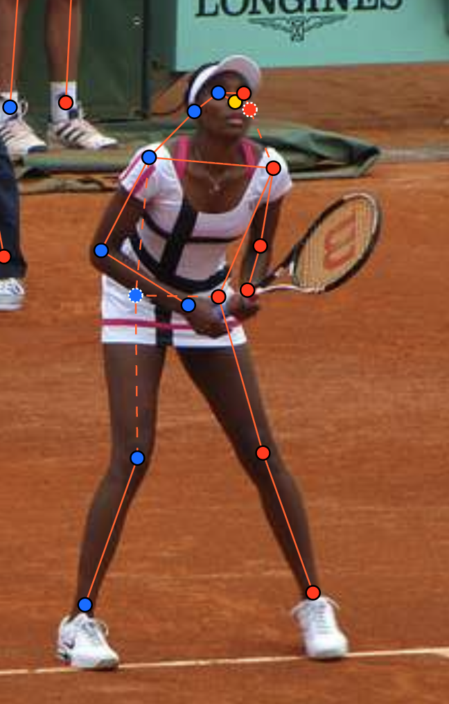
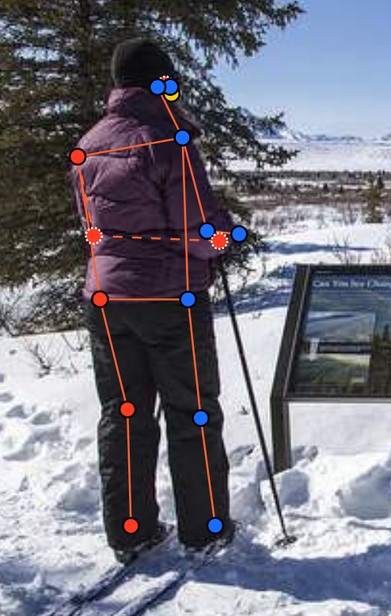
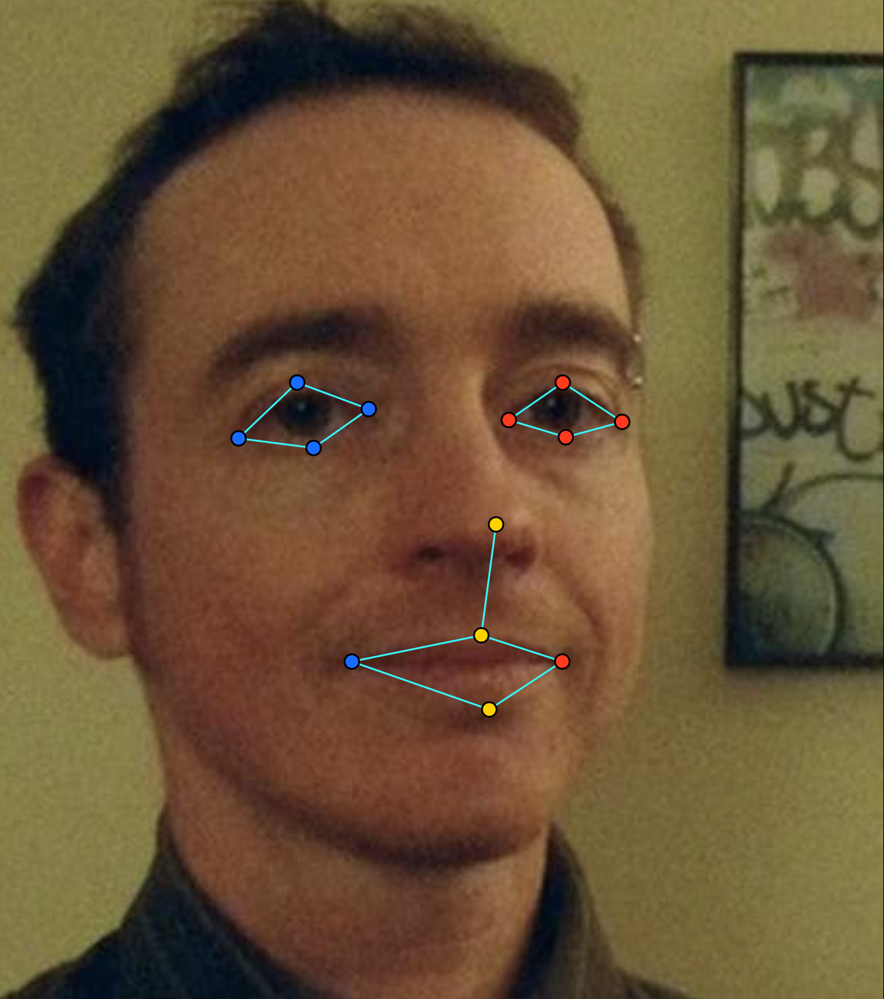
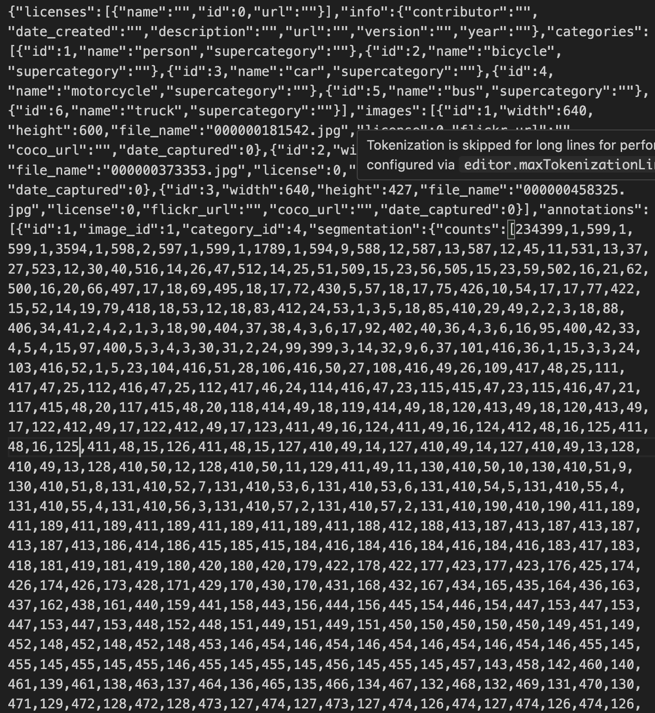

# Báo cáo cá nhân — HoVaTen-MSSV

Đổi tên file theo quy tắc `MSSV_HoTen.md`. Ví dụ: `20241234_NguyenVanAn.md`.

Dữ liệu: 12 ảnh người COCO val2017 (Lin et al., 2014) và 8 ảnh chân dung Wikimedia Commons, chỉ dùng trong lớp.

## 0. Thông tin học viên

- Họ tên: Trần Anh Văn
- MSSV: 2A202603058
- Email: 26ai.vanta3@vinuni.edu.vn
- Link repository: https://github.com/vanahtran/K5-L2A-DAY04-TranAnhVan-2A202603058-KeypointPose
- Phiên bản CVAT (Help → About): 
- Máy: MacOs · RAM 8 GB · chạy CVAT chế độ lite
- Bộ ảnh (`src/exports/assignment.json` do `lab.py setup` tạo): có 
- Giờ bắt đầu: 16h30 
- Giờ kết thúc: 19h30

## 1. Kiểm tra label (CP0)

| Label | Kiểu | Số điểm | Tên điểm đúng bảng của lab? | Đúng thứ tự? | Số cạnh |
|---|---|---:|---|---|---:|
| `person` | Skeleton | 17 | Có, theo `src/keypoint_schema.json` | Có, theo thứ tự schema | 19 |
| `face` | Skeleton | 13 | Có, theo `src/keypoint_schema.json` | Có, theo thứ tự schema | 13 |

Mẫu `person` dựng theo người quay mặt về camera (các điểm `left_*` nằm bên phải khung mẫu)? Có 

Cách đổi cờ `occluded` / `outside` cho **một điểm** trên phiên bản CVAT này (một câu):

Chọn điểm keypoint cần sửa rồi mở bảng thuộc tính của điểm chọn đổi Visibility sang Occluded (v=1) hoặc Outside (v=0) xong chọn lưu lại.  

## 2. Số lượng đã gán và thời gian (CP1, CP2)

| Nhóm ảnh | Số ảnh | Số skeleton đã gán | Số người dưới 60 px (không gán) | Số poster / gương / màn hình bỏ qua | Thời gian (phút) |
|---|---:|---:|---:|---:|---:|
| `easy` | 5 | 32 | 8 | 2 | 40 |
| `occluded` | 3 | 12 | 6 | 1 | 40 |
| `back` | 2 | 24 | 3 | 2 | 40 |
| `small` | 1 | 8 | 3 | 4 | 40 |
| `crowd` | 1 | 10 | 4 | 2 | 40 |
| `faces` | 8 | 27 | 4 | 5 | 40 |

- Số ảnh người đã xong ở mốc phút 105: 8 / 10
- Thời gian thực tế (phút): CP1 4 · CP2 4 · CP3 5
- Ảnh tốn thời gian nhất là ảnh nào, vì sao?

...

## 3. Bảng ca khó (CP1, CP2)

Mỗi điểm bạn phân vân một dòng, nhất là phân vân giữa `v = 1` và `v = 0`, hoặc không chắc hướng người.

| Ảnh | Người / mặt | Điểm | Cờ đã chọn | Phân vân giữa | Lý do chọn |
|---|---|---|---:|---|---|
| `000000189365.jpg` – skeleton #2 | Người | `right_ear` | `v=2` theo log lỗi lần export đầu | `v=2` / `outside (v=0)` | Tọa độ `(292, -2)` nằm ngoài ảnh; cần sửa thành `outside` trên CVAT. Đã hết lỗi ở lần export sau. |
| `000000163118.jpg` – skeleton #2 | Người | Hướng trái/phải toàn skeleton | Chưa xác nhận | `lr_swap` | Checker cảnh báo thấy mũi và hai mắt `v=2` nhưng các điểm `left_*` nằm bên trái ảnh; cần kiểm tra hướng người. |
| `000000253584.jpg` – skeleton #2 | Người | Các điểm keypoint | Đã export | Không áp dụng | Checker cảnh báo chiều cao vùng điểm là 49 px, dưới ngưỡng 60 px; cần xác nhận người thực tế nhỏ hay bị cắt khung. |
| `000000326480.jpg` – skeleton #4 | Người | Các điểm keypoint | Đã export | Không áp dụng | Checker cảnh báo chiều cao vùng điểm là 27 px, dưới ngưỡng 60 px; cần xác nhận người thực tế nhỏ hay bị cắt khung. |


## 4. Bảng tự review (CP3)

Đi từ ảnh cuối về ảnh đầu. 5 ảnh người (ít nhất 2 ảnh `back` hoặc `crowd`) và 3 ảnh mặt. Ít nhất 8 dòng, kể cả dòng `ok`. Ghi lỗi trước, sửa sau.

Mã lỗi dùng đúng một trong: `lr_swap`, `vis_flag`, `position`, `missing`, `extra`, `ok`.

| Ảnh | Người / mặt | Điểm | Mã lỗi | Ghi chú | Đã sửa? |
|---|---|---|---|---|---|
| person_05 | Người 1 | left_wrist | position | Cổ tay đặt lệch vị trí | Có |
| person_04 | Người 1 | right_eye | vis_flag | Cờ visibility chưa đúng | Có |
| person_03 | Người 1 (back) | left_shoulder | missing | Thiếu điểm vai trái | Có |
| person_02 | Người 2 (crowd) | right_knee | extra | Có điểm thừa | Có |
| person_01 | Người 1 | left_elbow | lr_swap | Nhầm bên trái và phải | Có |
| face_03 | Mặt 1 | left_eye | position | Điểm mắt đặt lệch | Có |
| face_02 | Mặt 1 | nose | ok | Vị trí điểm chính xác | Không |
| face_01 | Mặt 1 | mouth | ok | Vị trí điểm chính xác | Không |

Tổng hợp số lỗi theo mã:

| `lr_swap` | `vis_flag` | `position` | `missing` | `extra` | `ok` |
|---:|---:|---:|---:|---:|---:|
| 1 | 1 | 2 | 1 | 1 | 2 |

Điểm còn phân vân giữa `v = 1` và `v = 0` (ghi cả hai lựa chọn và lý do chọn):

Quy tắc cần đối chiếu khi hoàn thiện: `v=1` là điểm bị che khuất nhưng vị trí vẫn xác định được; `v=0` là điểm không nhìn thấy/ngoài ảnh theo hướng dẫn của lab.

## 5. Kiểm file xuất và kết quả tự kiểm (CP4)

Tự kiểm tay trong file JSON:

| File | Người / mặt kiểm (ảnh, thứ tự) | Số phần tử `keypoints` | Điểm `outside` ra `v = 0`, `occluded` ra `v = 1`? | `num_keypoints` khớp? |
|---|---|---:|---|---|
| `TranAnhVan_persons.zip` | Chưa ghi nhận mẫu kiểm tay | 51 số / annotation | Theo quy tắc export: outside `v=0`, occluded `v=1`; cần đối chiếu mẫu trực tiếp | Chưa ghi nhận kiểm tay |
| `TranAnhVan_persons.zip` | Chưa ghi nhận mẫu kiểm tay | 51 số / annotation | Theo quy tắc export: outside `v=0`, occluded `v=1`; cần đối chiếu mẫu trực tiếp | Chưa ghi nhận kiểm tay |
| `TranAnhVan_faces.zip` | Chưa ghi nhận mẫu kiểm tay | 39 số / annotation | Theo quy tắc export: outside `v=0`, occluded `v=1`; cần đối chiếu mẫu trực tiếp | Chưa ghi nhận kiểm tay |

Sau khi xuất, CVAT ghi `occluded` thành `v = ___` và `outside` thành `v = ___`. Tọa độ của điểm `outside` trong file là `0, 0` hay tọa độ cũ? ___

Hai job đã chuyển sang completed trên CVAT? Có / Không

Dán phần **TÓM TẮT** in ra từ `src/check_submission.py`:

```text
TÓM TẮT -----
- File person: TranAnhVan_persons.zip
  Số ảnh: 12 · số skeleton `person`: 21 · mỗi annotation 51 số
  Skeleton theo ảnh: 000000156069=1, 000000163118=2, 000000189365=2, 000000220045=1, 000000253584=2, 000000326480=4, 000000391222=2, 000000445187=1, 000000461389=3, 000000463932=1, 000000525227=1, 000000558066=1
  Cờ v: v=2 279 (78%) · v=1 43 (12%) · v=0 35 (10%)
  num_keypoints trung bình: 15.3
- File face: TranAnhVan_faces.zip
  Số ảnh: 8 · số skeleton `face`: 8 · mỗi annotation 39 số
  Skeleton theo ảnh: face_105668=1, face_125051=1, face_175798=1, face_204787=1, face_300399=1, face_356144=1, face_556064=1, face_99874=1
  Cờ v: v=2 96 (92%) · v=1 0 (0%) · v=0 8 (8%)
  num_keypoints trung bình: 12.0
- Ghi chú: 43 điểm v = 0 vẫn mang tọa độ cũ (CVAT 2.x xuất như vậy; chuẩn COCO ghi 0, 0). Không phải lỗi: điểm v = 0 bị bỏ qua khi huấn luyện và khi chấm.
- Số [LỖI]: 0 · số [CẢNH BÁO]: 3
Kết quả: ĐẠT 

```

Các `[CẢNH BÁO]` còn giữ nguyên và lý do:

...

## 6. Ảnh chụp màn hình

1. Label `person` trong label constructor (đủ 17 điểm có tên):

   

2. Một người quay lưng đã gán, cờ đã đặt:

   

3. Một khuôn mặt đã gán 13 điểm, phóng to vùng mắt:

   

4. Một đoạn JSON xuất của một người:

   

Nguồn ảnh: COCO val2017 / Wikimedia Commons.

## 7. Tự đánh giá

1. Lỗi bạn mắc nhiều nhất hôm nay, và cách bạn sẽ tránh ở dự án thật:

   Chưa ghi nhận phần tự đánh giá. Có một lỗi được checker phát hiện ở lần export đầu: điểm `right_ear` có tọa độ nằm ngoài ảnh nhưng vẫn đặt `v=2`. Sau khi sửa, lần export cuối không còn lỗi này. Khi làm dự án thật cần kiểm tra đồng thời vị trí điểm và visibility flag trước khi export.

2. Một quy tắc bạn đề xuất thêm vào guideline (kèm ảnh ví dụ nếu có):

   Chưa có

3. Nhãn của bạn đi vào model ở đâu? Chọn một lỗi bạn đã sửa và nói nó sẽ làm model học sai thế nào (heatmap, trọng số trong loss, hay bước lật ảnh):

    Chưa ghi nhận phần trả lời cá nhân. Có thể bổ sung dựa trên lỗi đã sửa ở `right_ear`: nếu điểm ngoài ảnh bị gán là nhìn thấy (`v=2`), model có thể học vị trí keypoint sai trong heatmap và bị kéo loss theo tọa độ không hợp lệ.

## 8. Khó khăn và lỗi kỹ thuật

- Máy sử dụng macOS, RAM 8 GB; đã chạy CVAT ở chế độ lite để giảm tải.
- Lệnh `python lab.py lite` không chạy vì máy không nhận lệnh `python` (`zsh: command not found: python`). Cần dùng `python3` trên môi trường hiện tại.
- Lệnh `python lab.py lite / full` được nhập nguyên cả phần lựa chọn nên shell báo `zsh: command not found: python`; đây không phải cú pháp lệnh hợp lệ.
- Lệnh `python3 lab.py stop` chạy thành công và trả về `[OK] Đã tắt CVAT`.
- `python3 lab.py export` xuất thành công đủ 4 file ZIP. Tuy nhiên, chương trình cảnh báo cả 4 job chưa ở trạng thái `completed`; cần vào từng job trong CVAT và chọn **Menu → Finish the job** sau khi kiểm tra xong.
- Lần export đầu có 1 lỗi và 3 cảnh báo. Sau khi sửa lỗi `right_ear` ngoài ảnh, lần export cuối đạt 0 lỗi và 3 cảnh báo.

## Bonus (nếu làm)

### B1 — 3 ảnh người khó thêm

| Ảnh | Số skeleton | Số người dưới 60 px | Ca khó nhất |
|---|---:|---:|---|
| `000000065350.jpg` | 3 | 2 | Chưa ghi nhận |
| `000000073537.jpg` | 2 | 1 | Chưa ghi nhận |
| `000000104800.jpg` | 2 | 1 | Chưa ghi nhận |

Tổng: 3 ảnh, 7 skeleton `person`, mỗi annotation có 51 số keypoint.

Kết quả `src/check_submission.py` cho `TranAnhVan_bonus_persons.zip`:


### B2 — 5 ảnh khuôn mặt đen trắng / hồng ngoại

Ảnh không màu khó hơn ở điểm nào? Kính râm trên ảnh hồng ngoại có còn là `v = 1` không?

Ảnh không màu (grayscale) khó gán keypoint hơn vì:
 Thiếu thông tin màu sắc: Khó phân biệt các bộ phận cơ thể có màu gần giống nhau.
 Khó nhận diện ranh giới: Quần áo, da và nền có thể có độ sáng tương tự.
 Khó xác định khớp: Các điểm như vai, khuỷu tay, cổ tay, đầu gối dễ bị nhầm khi hình ảnh thiếu chi tiết.
 Khó nhận diện vật thể: Một số vật dụng và bộ phận cơ thể khó phân biệt hơn.
 Có thể vẫn là v = 1, nhưng phải xét khả năng quan sát keypoint.

### B3 — Model so với nhãn của tôi (không tính điểm)

- Demo đã dùng:
- Ảnh đã thử:

1. Model có trả điểm cho khớp bị che, hay khớp ngoài ảnh không? Confidence ở các điểm đó thế nào?

   ...

2. Với người quay lưng, model có đổi trái/phải không?

   ...

3. Bộ điểm của model có giống 17 điểm COCO không?

   ...

## 9. Tài liệu tham khảo và công cụ AI đã dùng

- COCO val2017 — bộ ảnh người dùng trong bài thực hành.
- Wikimedia Commons — nguồn ảnh chân dung dùng trong bài thực hành.
- `src/keypoint_schema.json` — định nghĩa tên, thứ tự keypoint và cạnh skeleton cho `person` và `face`.
- `CHECKPOINTS.md` — yêu cầu và tiêu chí các checkpoint CP0–CP4.
- `src/check_submission.py` — công cụ tự kiểm file COCO Keypoints export.
- CVAT — công cụ gán nhãn keypoint.
- Công cụ AI hỗ trợ: ChatGPT — hỗ trợ đọc log, tổng hợp số liệu và soạn báo cáo.
